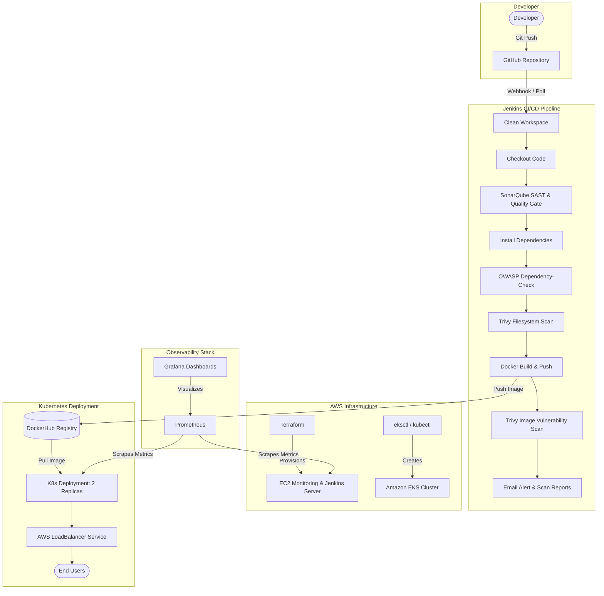

# 🎬 Disney+ Hotstar Clone - End-to-End DevSecOps Kubernetes Deployment

[](https://react.dev/)
[](https://nodejs.org/)
[](https://www.docker.com/)
[](https://kubernetes.io/)
[](https://www.terraform.io/)
[](https://www.jenkins.io/)
[](https://www.sonarqube.org/)
[](https://aquasecurity.github.io/trivy/)
[](https://prometheus.io/)
[](https://grafana.com/)

---

## 📌 Project Overview

This project demonstrates an enterprise-grade **DevSecOps Pipeline** and deployment of a **Disney+ Hotstar Clone (React.js + TMDB API)** onto **Amazon EKS (Elastic Kubernetes Service)** using **Infrastructure as Code (Terraform)**, **Jenkins CI/CD**, continuous security scanning, and **Prometheus & Grafana** observability.

### ✨ Key Features

- **Frontend App**: Responsive Disney+ Hotstar streaming UI built with React 18, Axios, and the TMDB API.
- **Infrastructure as Code (IaC)**: Automated provisioning of AWS EC2 monitoring/management instances using Terraform.
- **CI/CD Automation**: Fully declarative Jenkins pipeline automating testing, static code analysis, security auditing, container builds, and deployment.
- **Shift-Left Security (DevSecOps)**:
  - **SonarQube**: Code quality and static application security testing (SAST) with Quality Gates.
  - **OWASP Dependency-Check**: Software Composition Analysis (SCA) to detect known CVEs in third-party dependencies.
  - **Trivy**: Comprehensive scanning of both the filesystem and final Docker container images.
- **Container Orchestration**: Production-grade Kubernetes manifests with 2 replicas, RollingUpdate strategy, and AWS LoadBalancer integration.
- **Observability**: Real-time metrics scraping with Prometheus and visual monitoring dashboards in Grafana.
- **Notifications**: Automated build status alerts and security scan reports emailed to stakeholders.

---

## 🏗️ Architecture & DevSecOps Flow



---

## 🛠️ Tech Stack & Tooling

| Domain | Tool / Technology | Purpose |
| --- | --- | --- |
| **Frontend** | React 18, Axios, HTML5, CSS3 | Single Page Streaming Application |
| **Data Provider** | TMDB (The Movie Database) API | Dynamic movie & TV series catalogs |
| **Source Control** | GitHub | Version control and collaborative development |
| **CI/CD** | Jenkins | Declarative automated pipeline |
| **IaC** | Terraform | Provisioning AWS EC2 & Security Groups |
| **Code Quality** | SonarQube | Static code analysis and Quality Gate checks |
| **Security (SCA)** | OWASP Dependency-Check | Dependency CVE vulnerability identification |
| **Security (Container)** | Trivy | Vulnerability scanner for filesystem & container images |
| **Containerization** | Docker | Container build & image packaging |
| **Container Registry** | Docker Hub | Public/Private container image repository |
| **Orchestration** | Kubernetes / Amazon EKS | Container management, self-healing, rolling updates |
| **Monitoring** | Prometheus | Real-time metric scraping and time-series data storage |
| **Visualization** | Grafana | Metric visualization and alerting dashboards |

---

## 📁 Repository Directory Structure

```text
hotstar-kubernetes/
├── Dockerfile                         # Container build instructions
├── Jenkinsfile                        # Declarative Jenkins CI/CD pipeline
├── package.json                       # Node.js dependencies and scripts
├── promotheus_configfile.txt          # Prometheus scrape job configurations
├── README.md                          # Project documentation
│
├── K8S/                               # Kubernetes deployment resources
│   ├── eks-cluster-and-Deployment-guide.txt  # Step-by-step EKS setup guide
│   ├── Jenkinsfile                    # Alternate pipeline for EKS deployment
│   └── manifest.yml                   # K8s Deployment & LoadBalancer Service
│
├── Terraform/                         # Infrastructure as Code
│   ├── main.tf                        # AWS Provider, Security Group, EC2 instance
│   ├── variables.tf                   # Input variable definitions
│   ├── output.tf                      # Outputs (Public IP, instance info)
│   └── jenkinsfile                    # Pipeline configuration for Terraform
│
├── scripts/                           # Automation & installation helper scripts
│   ├── awscli.sh                      # AWS CLI v2 installation
│   ├── docker.sh                      # Docker Engine installation
│   ├── eksctl.sh                      # eksctl CLI installation
│   ├── grafana.sh                     # Grafana server installation
│   ├── jenkins.sh                     # Jenkins & Java installation
│   ├── kubectl.sh                     # Kubernetes CLI installation
│   ├── terraform.sh                   # HashiCorp Terraform installation
│   ├── trivy.sh                       # Aqua Security Trivy installation
│   └── permissionexecute.sh           # Batch script permission utility
│
├── public/                            # Static web assets
│   ├── index.html
│   └── manifest.json
│
└── src/                               # React source code
    ├── components/                    # UI Components (Banner, Nav, Row, Footer)
    ├── App.js                         # Main application root
    ├── request.jsx                    # TMDB API endpoint queries
    └── tmdbAxiosInstance.js           # Axios HTTP client configuration
```

---

## 🚀 Getting Started Locally

### 1. Prerequisites

- **Node.js** (v18.x or later)
- **npm** (v9.x or later)
- **Docker** (optional, for local container runs)

### 2. Clone the Repository

```bash
git clone https://github.com/ramsinghyadav4472/Disney_Hotstar_DevSecOps.git
cd hotstar-kubernetes
```

### 3. Install Dependencies & Run

```bash
# Install NPM packages
npm install

# Start the local development server
npm start
```

The app will be available at **[http://localhost:3000](http://localhost:3000)**.

### 4. Build for Production

```bash
npm run build
```

---

## 🐳 Running with Docker

### Build Image

```bash
docker build -t hotstar:latest .
```

### Run Container

```bash
docker run -d --name hotstar-app -p 3000:3000 hotstar:latest
```

Access the application at `http://localhost:3000`.

---

## ☁️ Infrastructure as Code (Terraform)

The [`Terraform/`](Terraform/) directory provisions the monitoring and management host on AWS:

```bash
cd Terraform

# Initialize Terraform plugins
terraform init

# Review planned infrastructure changes
terraform plan

# Apply configuration to create AWS resources
terraform apply -auto-approve
```

---

## ☸️ Kubernetes (Amazon EKS) Deployment

1. **Create the EKS Cluster using `eksctl`**:

   ```bash
   eksctl create cluster \
     --name hotstar-cluster \
     --region ap-south-1 \
     --node-type t2.medium \
     --nodes 2
   ```

2. **Deploy Manifests**:

   ```bash
   kubectl apply -f K8S/manifest.yml
   ```

3. **Verify Deployment & Service**:

   ```bash
   kubectl get pods -l app=hotstar
   kubectl get service hotstar-service
   ```

   Open the external LoadBalancer DNS name provided by `hotstar-service` in your browser.

---

## 📊 Monitoring & Observability

- **Prometheus**: Configured via `promotheus_configfile.txt` to scrape metrics from the application, Node Exporter, and Kubernetes nodes.
- **Grafana**: Access the Grafana UI on port `3000` (or configured host port) and import dashboards (e.g., Kubernetes Cluster Monitoring, Node Exporter Full) to visualize:
  - CPU & Memory utilization
  - Pod health and replica counts
  - Network throughput and response times

---

## 🔒 Security Best Practices Implemented

- **Static Code Analysis**: Enforced quality gate thresholds in SonarQube to prevent code smells and bugs from entering production.
- **Software Composition Analysis**: OWASP Dependency-Check analyzes `package.json` dependencies against the National Vulnerability Database (NVD).
- **Vulnerability Scanning**: Trivy evaluates filesystem vulnerabilities and inspects built container images for OS and package CVEs.
- **Least Privilege Access**: Dedicated security groups for instances and Kubernetes RBAC policies.

---
